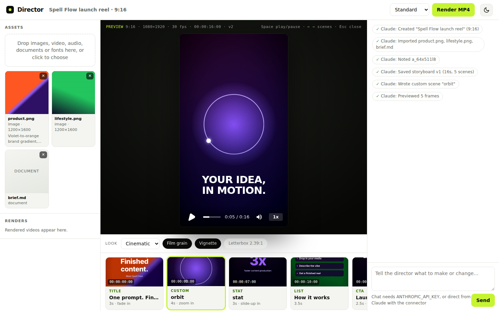
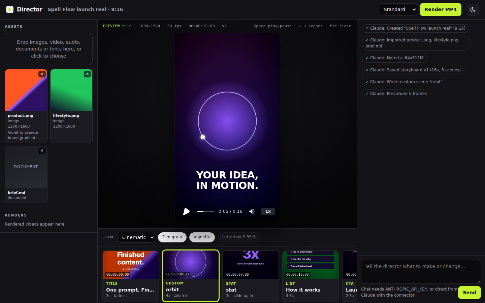
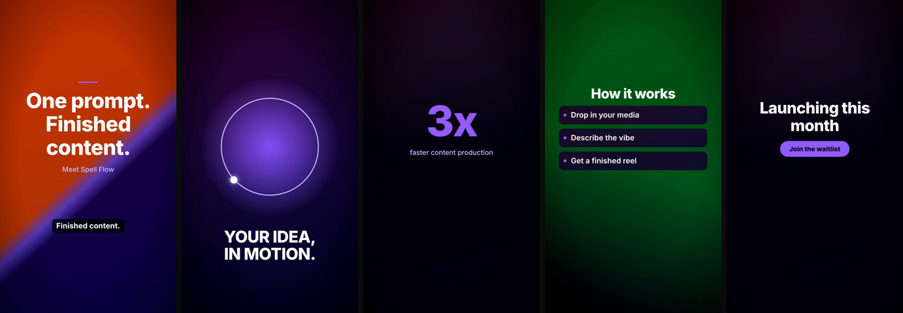

# Director

Director is an AI video studio. You upload images, footage, audio, documents or a script, and an AI director built on Claude plans the video. It writes the narration, chooses shots and trims, designs motion graphics, checks its own work and renders an MP4. The rendering engine is [HyperFrames](https://github.com/heygen-com/hyperframes) (Apache-2.0), which renders HTML compositions to video frame by frame, so every edit appears in a live preview and renders deterministically.

```
upload  ─►  ingest (probe, transcode, keyframes, text)  ─►  AI director (Claude + tools)
                                                              │  save_plan / edit_scene / write_custom_scene
                                                              ▼
            MP4  ◄─  HyperFrames render  ◄─  lint  ◄─  compile storyboard → HTML composition  ─►  live preview
```







## What it does

- **Bring anything.** Accepts images, video (anything FFmpeg reads; formats a browser can't play are transcoded to H.264), audio, PDF, DOCX, Markdown, HTML, plain-text scripts, and fonts. Documents are turned into text the director can read, and videos get keyframes it can look at.
- **Chat with the director.** Describe the video you want. The director looks at your material, writes the full storyboard (scenes, on-screen text, narration, transitions, music), previews the result and fixes what it sees. Follow-up messages make targeted edits.
- **Scene templates.** Title, statement (word-by-word reveal), media (full-bleed photo or clip with Ken Burns motion and trims), list, animated stat counter, quote, call to action, and **custom** scenes where the director writes its own HTML/CSS motion graphics. Custom scenes are sandboxed: no scripts, no remote URLs.
- **Voice and captions.** Narration per scene becomes timed captions. With a voice provider configured (Kokoro through HyperFrames, ElevenLabs, or any local command such as Piper or Chatterbox), the director generates the voiceover and lengthens scenes to fit it. Music ducks automatically under narration.
- **Generated footage (optional).** Shots made with an AI video tool come in by link with `import_from_url`. In Claude Desktop or Claude Code with the Higgsfield connector, Claude can generate a shot there and drop it straight into the edit. You can also point `GENVIDEO_COMMAND` at your own text/image-to-video model (for example a Wan 2.2 or LTX-2 script, or a ComfyUI workflow). Generated shots are labelled as AI-generated.
- **Cinematic finish.** A film look for the whole video:
  - colour grades: cinematic, noir, warm, cool, vivid or matte
  - film grain and vignette
  - 2.39:1 letterbox for 16:9, with text kept inside the bars
  - camera moves, including slow dolly-in, crash-zoom and drift
  - flash and whip transitions
- **Edit by hand too.** The studio has a storyboard strip of real frame thumbnails with timecode, a film-look bar, and a scene editor (text, duration, media, motion, transition, voiceover, order), so you can work without the AI at all. Keyboard: Space plays, ← → move between scenes, Esc closes the editor.
- **Light and dark.** White, black and lime by default, plus a dark studio; the preview stage stays dark in both, like a screening room.
- **Render.** Draft, standard, high and 4K master renders run in a queue with live progress, cancellation and downloads. Formats: 9:16, 16:9, 1:1, 4:5 at 24/30/60 fps; 4K is available for 9:16, 16:9 and 1:1.

## Use it from Claude (connector and plugin)

Director includes a connector (an MCP server), so Claude itself can direct the edit from Claude Code or Claude Desktop. Claude plans the storyboard, looks at your footage, previews frames, fixes problems and renders, using your Claude plan. No API key is needed. The studio page opens alongside at http://127.0.0.1:4321 with a live preview that updates after every change Claude makes, and you can edit there too.

You need Node.js 22+ and FFmpeg on your computer (macOS: `brew install ffmpeg`; Windows: `winget install ffmpeg`).

**Claude Code plugin**

The plugin lives on this repository's default branch once this work is merged:

```
/plugin install video-director --marketplace berry1200/her-stimulation
```

Before that, install it from a local clone instead:

```bash
claude plugin marketplace add /path/to/her-stimulation
claude plugin install video-director@her-stimulation
```

The first start installs Director's dependencies in the background (1-3 minutes). When it finishes, reconnect the `director` server with `/mcp`. The plugin also adds a `video-director` skill that tells Claude how to run the studio.

**Claude Code without the plugin**

```bash
cd director && npm install && npm run setup
claude mcp add director -- node /absolute/path/to/director/scripts/start-mcp.mjs
```

**Claude Desktop**

Run `npm install && npm run setup` in `director/`. Then open Settings → Developer → Edit Config, add the server to `claude_desktop_config.json`, and restart Claude Desktop:

```json
{
  "mcpServers": {
    "director": {
      "command": "node",
      "args": ["/absolute/path/to/her-stimulation/director/scripts/start-mcp.mjs"]
    }
  }
}
```

**What Claude can do through it**

| Tool | Purpose |
| --- | --- |
| `director_guide` | The full workflow, scene kinds, style and motion-graphics rules |
| `list_projects`, `create_project` | Find or start a video; returns the studio link |
| `import_files` | Bring in local images, video, audio, documents, scripts and fonts by path |
| `import_from_url` | Download files from direct http(s) links, such as shots generated with Higgsfield |
| `get_project`, `view_assets`, `note_asset` | Read the project and look at the material (pictures and keyframes) |
| `save_plan`, `edit_scene`, `write_custom_scene` | Write and change the storyboard and custom motion graphics |
| `preview` | Real frames from the cut, so Claude can check its work |
| `generate_voiceover`, `generate_clip` | Voice and generated footage, when providers are configured |
| `render_video`, `render_status`, `save_render` | Render the MP4 and copy it where you want |

There is also a `make_video` prompt (in Claude Code: `/mcp__director__make_video`). Projects are stored in `~/Director`. A running studio (`npm start`) serves the same tools over HTTP at `http://127.0.0.1:4321/mcp`, for example `claude mcp add --transport http director http://127.0.0.1:4321/mcp`.

To use Director from claude.ai in a browser or on a phone, it has to be hosted on a server with HTTPS and a sign-in. That is a separate step and is not set up yet.

## Quick start (studio with its built-in agent)

Requirements: Node.js 22+, FFmpeg and ffprobe, and Chrome or Chromium. Optional: `pdftotext`/`pdftoppm` (poppler-utils) for PDFs and `unzip` for DOCX.

```bash
cd director
npm install
export ANTHROPIC_API_KEY=sk-ant-...      # enables the AI director
npm start                                # http://127.0.0.1:4321
```

Without an API key the studio still runs: you can upload, build storyboards by hand, preview and render. To check the whole pipeline without a key or a browser session, run:

```bash
npm run demo     # compiles a sample storyboard, lints it, takes snapshots and renders a draft MP4
```

If HyperFrames can't find a browser, set `HYPERFRAMES_BROWSER_PATH` to a Chrome/Chromium binary, or run `npx hyperframes browser` / `npx hyperframes doctor`.

## Configuration

| Variable | Default | Purpose |
| --- | --- | --- |
| `ANTHROPIC_API_KEY` | (none) | Claude API key for the director. `ANTHROPIC_AUTH_TOKEN` also works. |
| `DIRECTOR_MODEL` | `claude-opus-5-5` | Model that directs the edit. |
| `DIRECTOR_EFFORT` | `high` | `low`, `medium`, `high`, `xhigh` or `max`. |
| `DIRECTOR_MAX_STEPS` | `24` | Maximum API calls (tool steps) per message. |
| `PORT` / `HOST` | `4321` / `127.0.0.1` | Where the studio listens. |
| `DIRECTOR_DATA_DIR` | `~/Director` | Projects, uploads, builds and renders. |
| `DIRECTOR_UI` | on | `off` stops the connector from also serving the studio page. |
| `DIRECTOR_THUMBNAILS` | on | `off` stops the frame thumbnails made in the background after each save. |
| `DIRECTOR_URL_IMPORT` | on | `off` turns off downloading files from links. |
| `DIRECTOR_ALLOW_PRIVATE_URLS` | off | `1` allows links to this computer or a private network (for testing only). |
| `DIRECTOR_IMPORT_ROOTS` | (any) | Folders the connector may import from, separated like `PATH`. Hidden files and folders are always refused. |
| `DIRECTOR_MCP_TOKEN` | (none) | Bearer token for `/mcp`. Required when the studio listens on a non-local address. |
| `DIRECTOR_ALLOWED_HOSTS` | (none) | Extra host names the studio answers to besides localhost (DNS-rebinding protection). |
| `DIRECTOR_MAX_UPLOAD_MB` | `512` | Per-file upload limit. |
| `HYPERFRAMES_BROWSER_PATH` | auto-detected | Chrome/Chromium used for previews and renders. |
| `TTS_PROVIDER` | `none` | `hyperframes` (local Kokoro-82M; `npx hyperframes doctor` shows what it needs), `elevenlabs`, or `command`. |
| `TTS_VOICE` | `af_heart` | Voice id for the provider (an ElevenLabs voice id when using ElevenLabs). |
| `TTS_COMMAND` | (none) | For `command`: argv template with `{text}`, `{out}`, `{voice}`. Run without a shell. |
| `ELEVENLABS_API_KEY`, `ELEVENLABS_MODEL` | (none), `eleven_multilingual_v2` | For `elevenlabs`. |
| `GENVIDEO_PROVIDER` | `none` | `command` to enable generated clips. |
| `GENVIDEO_COMMAND` | (none) | Argv template with `{prompt}`, `{seconds}`, `{aspect}`, `{image}`, `{out}`. |

Examples:

```bash
# Local voices with Kokoro-82M through the HyperFrames CLI (model downloads on first use)
TTS_PROVIDER=hyperframes TTS_VOICE=af_heart npm start

# Any other voice engine through a small wrapper that writes a WAV
TTS_PROVIDER=command TTS_COMMAND='./speak.sh {text} {out}' npm start

# Generated clips from your own model script
GENVIDEO_PROVIDER=command GENVIDEO_COMMAND='python wan_generate.py --prompt {prompt} --seconds {seconds} --aspect {aspect} --image {image} --out {out}' npm start
```

`speak.sh` and `wan_generate.py` stand for your own scripts. For example, `speak.sh` could pipe its first argument into Piper (`printf %s "$1" | piper --model en_US-amy-medium.onnx --output_file "$2"`), or call Chatterbox or Qwen3-TTS. Placeholders are substituted inside single arguments and nothing runs through a shell, so text the model writes cannot inject shell syntax.

## Using it well

- Upload the material first, then write a brief in chat: who the video is for, the length, the tone, and the format.
- Ask for changes in plain language: "make the hook punchier", "use the second clip from 0:12", "swap to a light palette", "add a stat scene: 42% faster".
- Click a scene in the strip to jump the preview to it and edit it by hand.
- Render a draft for a quick review, then a standard or high quality final.

## API

The UI uses a small JSON API, so other tools can drive the studio too:

| Method | Path | |
| --- | --- | --- |
| `GET` | `/api/health` | Model and effort, voice and video providers, whether Claude is configured, accepted file types. |
| `GET/POST` | `/api/projects` | List or create (`{name, format, brief}`). |
| `GET/PATCH/DELETE` | `/api/projects/:id` | Project, activity feed and agent state. |
| `POST` | `/api/projects/:id/assets` | Multipart upload, field `files`. |
| `POST` | `/api/projects/:id/assets/url` | Download a file from a link (`{url, note}`). |
| `DELETE` | `/api/projects/:id/assets/:assetId` | Refused while the storyboard uses the asset. |
| `PUT` | `/api/projects/:id/plan` | Replace the storyboard (validated, compiled, linted). |
| `POST` | `/api/projects/:id/plan/starter` | First cut from the uploads. |
| `PATCH` | `/api/projects/:id/scenes/:sceneId` | `{changes}` (null removes a field) or `{delete: true}`. |
| `POST` | `/api/projects/:id/chat` | `{message}` starts a director turn (202). |
| `POST/DELETE` | `/api/projects/:id/renders[/:renderId]` | Queue (`{quality}`) or cancel a render. |
| `GET` | `/api/projects/:id/events` | Server-sent events: feed, agent, plan, assets, render. |
| `GET` | `/files/:id/{assets,previews,build,renders}/...` | Media with range requests; `?download` for attachments. |
| `POST` | `/mcp` | The Claude connector over MCP streamable HTTP. |

## Development

```bash
npm test           # unit, ingest/compile, agent loop (mock Claude API), connector (MCP client) and HTTP tests, including real renders
npm run typecheck
npm run dev        # restart on changes
```

The agent test drives the full director loop (view assets, note, save plan, preview, reply) against a scripted mock of the Messages API. It checks the request shape: model, effort, server-side fallback, cached system prompt, and an append-only history that keeps thinking blocks intact.

## Security and content notes

- The studio is a single-user local tool. It binds to `127.0.0.1` and has no login. Put it behind authentication before exposing it to a network. While it listens locally, it only answers requests addressed to localhost, so web pages can't reach it through DNS rebinding.
- The connector's `import_files` reads only the paths Claude passes, refuses hidden files and folders such as `~/.ssh` (symlinks are resolved first), and can be limited to chosen folders with `DIRECTOR_IMPORT_ROOTS`.
- Link imports (`import_from_url` and the studio's link field) download only from public internet addresses. Links to this computer or a private network are refused, and every redirect is checked again. Without a proxy, the connection is pinned to the address that was checked. Downloads are capped in size and time, a link must return a file type Director can use, and the stored source keeps no query string (signed links often carry access tokens). `DIRECTOR_URL_IMPORT=off` turns link import off.
- Uploads are allowlisted by type and stored under generated ids. File serving is limited to assets, previews, builds and renders, and path traversal is rejected.
- Custom-scene HTML written by the model is validated before use. Scripts, embedded documents, forms and event handlers are rejected, including entity-encoded tricks. URLs are allowlisted (asset placeholders, `#fragments`, data-URI images), CSS must be scoped to its scene, and timing must fit the scene.
- External tools run with `execFile` and argv templates, never through a shell.
- The director won't make sexual or nude content, impersonate real people or clone a voice without consent. Clear-cut requests are screened before any API call, and the model enforces the rest.

## Known limitations

- Video in the live preview depends on the browser's codecs. Chrome, Edge, Safari and Firefox play H.264, but some bare Chromium builds don't, and video areas then preview black. Renders are not affected.
- `TTS_PROVIDER=hyperframes` runs Kokoro locally. It needs a one-time setup, which `npx hyperframes doctor` reports, and the model downloads on first use. Kokoro voices are preset; it does not clone voices.
- No model is bundled for generated video. Bring your own (see `docs/RESEARCH.md` for options and their licences).
- Motion is CSS keyframes only. GSAP is free, but its licence excludes tools that compete with Webflow's visual builder, so this project avoids it.

See [docs/ARCHITECTURE.md](docs/ARCHITECTURE.md) for how the pieces fit together and [docs/RESEARCH.md](docs/RESEARCH.md) for the analysis of HyperFrames and the open-source tools around it.
